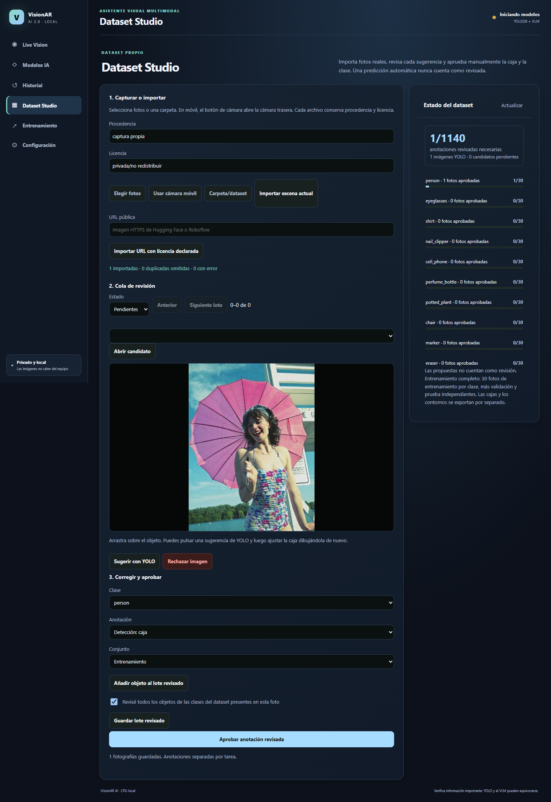
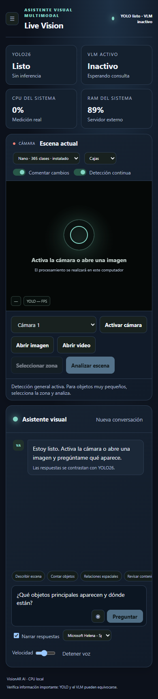
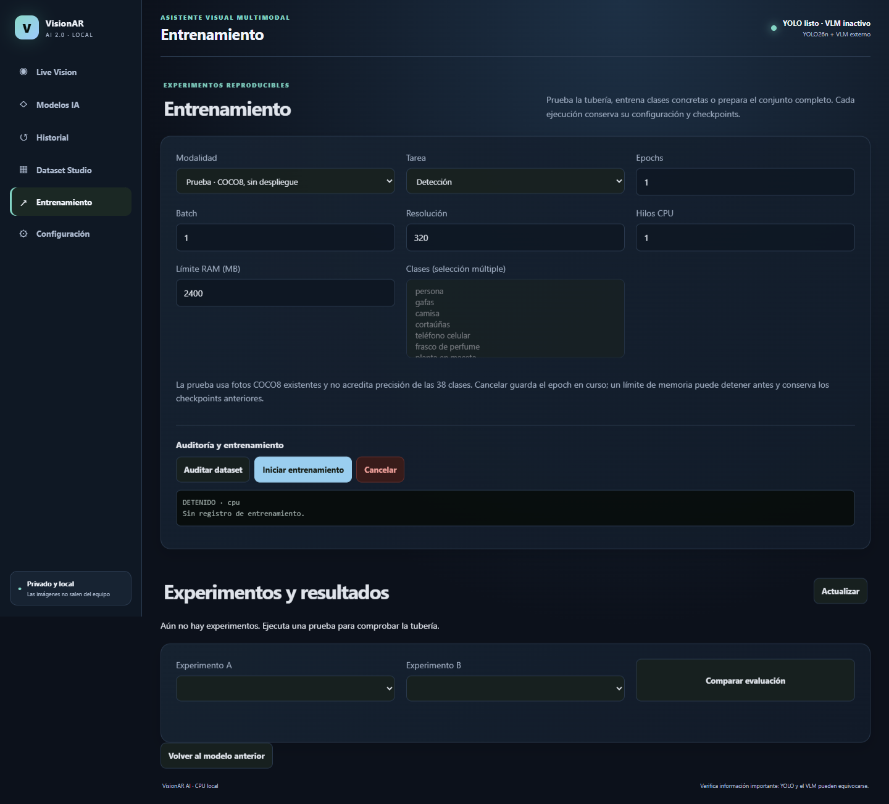
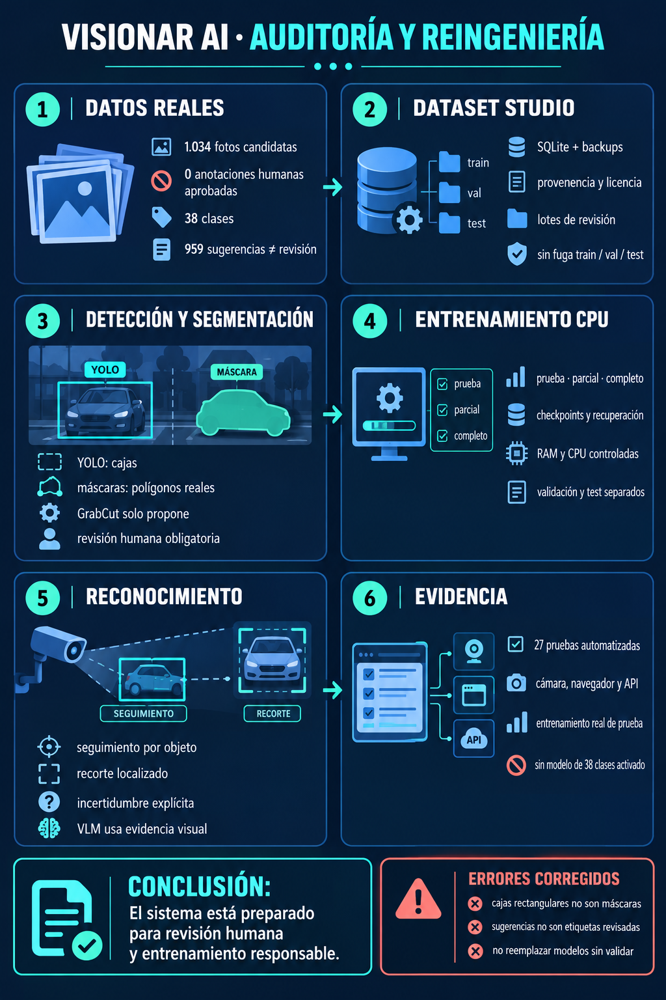

# VisionAR AI

> Asistente visual local con cámara, detección de objetos y razonamiento con IA. Todo funciona en tu equipo, sin enviar datos a la nube.



## ¿Qué es VisionAR AI?

VisionAR AI es una aplicación local (CPU) que combina:

- **YOLO26n** para localizar, etiquetar y contar objetos en tiempo real.
- **Modelos visión-lenguaje (VLM)** (SmolVLM / Qwen2-VL) para interpretar la escena y responder preguntas en español.
- Un **dashboard web local** (`http://127.0.0.1:8080`) sin dependencias JavaScript externas.
- **Dataset Studio** para curar datos propios y entrenar modelos YOLO en CPU.

Las detecciones de YOLO se convierten en evidencia estructurada que se añade a la consulta del VLM, sin tratarse como verdad absoluta: el prompt obliga a contrastarlas con la imagen e indicar incertidumbre.

## Características principales

- Detección en vivo con cámara web, con cajas, etiquetas y conteos.
- Modo **General** unificado con 365 clases (Objects365) para detección y segmentación.
- Análisis de escena con VLM: descripción y preguntas abiertas en español.
- Selección de zona (recorte) para objetos pequeños o clases ausentes.
- Narración por voz configurable (activar/detener, voz, velocidad).
- Análisis de video local (MP4/WebM/OGG/MOV) sin subir archivos al backend.
- Historial efímero de sesión (las imágenes no se guardan).
- Gestión de modelos VLM instalados desde la interfaz.
- Dataset Studio: anotación de cajas y máscaras, exportación y entrenamiento CPU.
- API local documentada y restringida a `127.0.0.1`.

## Vista de la interfaz

| Escritorio | Móvil |
|---|---|
|  |  |



## Arquitectura

```
Navegador (web/)  <-->  Python (scripts/vision_web_server.py, :8080)
                              |
                              +--> YOLO26 (visual_fusion.py)
                              +--> llama.cpp (vlm_engine.py, :8091)  [VLM]
```

- `scripts/start_assistant.py`: ciclo de vida coordinado.
- `scripts/vlm_engine.py`: descubre llama.cpp, modelos instalados, inicia/detiene el proceso propio y cambia el VLM.
- `scripts/visual_fusion.py`: decodifica la imagen, ejecuta YOLO26 y produce cajas normalizadas, conteos y contexto verificable.
- `scripts/vision_web_server.py`: API local, cola VLM de una solicitud, historial efímero y límites de carga.
- `web/`: dashboard local responsive sin dependencias JavaScript.

Los puertos 8080 y 8091 solo escuchan en `127.0.0.1`. llama.cpp recibe una clave aleatoria distinta en cada ejecución.

## Requisitos

- Windows (probado) con Python 3.x.
- Node.js / npm (para los scripts).
- Git.
- ~12 GB de RAM recomendados para el modo estable (SmolVLM).
- (Opcional) GPU no requerida; todo corre en CPU.

## Instalación rápida

```powershell
cd C:\Users\alexi\Desktop\vision\VISIONAR-AI
python -m pip install -r requirements.txt
npm run dev
```

Abra `http://127.0.0.1:8080` si el navegador no se abre automáticamente.

En la primera ejecución, `llama.cpp` descarga aproximadamente 1,70 GB para el VLM. Las ejecuciones posteriores reutilizan la caché de Hugging Face.

## Comandos disponibles

```powershell
npm run dev          # asistente web VLM (SmolVLM por defecto)
npm run dev:qwen     # mayor calidad visual (más RAM)
npm run camera       # detector YOLO en tiempo real con voz
npm run dev:focus    # YOLO limitado a 5 clases de Fase 1
npm run demo         # reconocimiento YOLO sobre imagen real
npm run test         # pruebas automatizadas
```

Más comandos en `package.json` (evaluación, dataset, verificación, etc.).

## Uso básico

1. Autorice la cámara o pulse **Abrir imagen**.
2. Active **Detección en vivo** si desea cajas YOLO periódicas.
3. Pulse **Analizar escena** para capturar un fotograma nuevo.
4. Escriba preguntas adicionales para conversar sobre el mismo fotograma.
5. Use **Modelos IA** para cambiar entre los VLM instalados.
6. Use **Historial** para revisar la sesión actual (las imágenes no se guardan).

### Detección general unificada

La interfaz tiene un solo modo **General**. Nano usa `yolo26n-objv1-150.pt` (Objects365, 365 clases). La tarea **Máscaras** usa `yolo26n-objv1-seg.pt` con el mismo vocabulario. Incluye persona, gafas, tenis, silla, escritorio, armario/estante, bolso, almohada, planta, marcador, borrador, televisor, peces, mascotas, moto, cubiertos, cartuchera, cinta y destornillador, entre otros.

Para objetos diminutos o clases ausentes (cortaúñas, USB, billetera, tarjeta), use **Seleccionar zona** y **Analizar escena**: Qwen2-VL inspecciona el recorte en el mismo modo General. Colores, estampados y materiales son atributos del análisis visual, no modos separados.

### Análisis de video

1. Pulse **Abrir video** y seleccione MP4/H.264, WebM, OGG o MOV compatible con Edge.
2. Reproduzca, pause o avance con los controles del visor.
3. YOLO dibuja detecciones continuamente sobre los fotogramas reproducidos.
4. Pause en cualquier instante y pulse **Analizar escena** o escriba una pregunta.

El archivo completo nunca se carga al backend ni se guarda: el navegador lo abre mediante una URL temporal local y envía únicamente fotogramas JPEG reducidos.

## API local

| Ruta | Función |
|---|---|
| `GET /api/status` | Salud, modelo activo y consumo real |
| `GET /api/models` | Catálogo instalado y estado |
| `POST /api/models/select` | Cambia el VLM administrado |
| `POST /api/detect` | Inferencia YOLO sobre una imagen |
| `POST /api/analyze` | Fusión YOLO + VLM |
| `GET /api/history` | Metadatos efímeros de la sesión |

## Dataset Studio y entrenamiento

VisionAR incluye un estudio de datasets con SQLite, anotación de cajas (YOLO, 5 campos) y contornos de segmentación, validación, exportación por experimento y entrenamiento CPU configurable (prueba/parcial/completo).

```powershell
python scripts/train_visionar.py --execute --mode smoke --epochs 1 --model training/checkpoints/yolo26n.pt
python scripts/train_visionar.py --mode partial --classes person chair
```

Ver `docs/REINGENIERIA.md` para detalles de reingeniería y evidencias.

## Auditoría y calidad



## Verificación

Con VisionAR activo:

```powershell
npm run fusion:test
```

Pruebas unitarias y validación de sintaxis:

```powershell
npm test
npm run tracking:test
node --check web/app.js
python -m py_compile scripts/*.py
```

Verificación completa:

```powershell
npm run verify:runtime
npm run verify:recovery
npm run verify:dashboard
npm run verify:multimodal
```

## Estructura del proyecto

```
VISIONAR-AI/
├── assets/            # Recursos (animaciones, modelos 3D, miniaturas)
├── datasets/          # Datasets y anotaciones
├── docs/              # Documentación, evidencias e infografías
├── knowledge/         # Conocimiento de objetos y esquemas
├── outputs/           # Salidas generadas
├── scripts/           # Backend Python y utilidades
├── tests/             # Pruebas
├── training/          # Configuración y checkpoints
├── web/               # Dashboard local (HTML/CSS/JS)
├── package.json
├── requirements.txt
└── README.md
```

## Limitaciones conocidas

- Qwen2-VL tarda decenas de segundos por consulta en CPU (Intel Core i5-10210U); por eso no se ejecuta sobre todos los fotogramas.
- Objects365 amplía la cobertura a 365 clases, pero no sustituye la validación con fotografías reales del usuario.
- El FPS equivalente mostrado es `1000 / latencia de inferencia`; no representa necesariamente la frecuencia final de la cámara.
- El historial está en memoria y se pierde al cerrar VisionAR.
- Las respuestas del VLM pueden alucinar; no usarlas como certeza técnica o de seguridad.
- Biblioteca 3D y WebXR son fases posteriores.

## Licencias y fuentes

- llama.cpp: distribución oficial, licencia MIT del proyecto.
- Qwen2-VL 2B GGUF: modelo derivado de Qwen2-VL; revisar Apache-2.0 y la ficha antes de redistribuir.
- Datasets: requieren conservar y revisar la licencia por imagen antes de redistribución o uso comercial. Ver `LICENCIAS_Y_FUENTES.md`.

## Documentación adicional

- [Reingeniería y evidencias](docs/REINGENIERIA.md)
- [Asistente visual local](README_ASISTENTE_VISION.md)
- [VisionAR AI 2.0](README_VISIONAR_2.md)
- [Dataset propio](README_DATASET_PROPIO.md)
- [Fase 1](README_FASE_1.md)
- [Fase 0 (histórico)](README.md) — este mismo archivo conserva el contenido original arriba.

## Autor

Proyecto personal: [Aleixein466/Vision-CP](https://github.com/Aleixein466/Vision-CP)
```

Wait, I referenced README.md as Fase 0 histórico, but we are overwriting README.md. That's circular. Remove that line or adjust. The original README content will be lost; but user asked better readme. We can mention historical docs maybe not needed. Remove that bullet. Also "Fase 0 (histórico)" not needed. Let's remove.

Also note: "npm run dev" uses smolvlm-500m according package. Good.

Let's write file.<|end|><|start|>assist to=write<|channel|>analysis <|constrain|>xml<|message|><rfl:parameter name="content">
# VisionAR AI

> Asistente visual local con cámara, detección de objetos y razonamiento con IA. Todo funciona en tu equipo, sin enviar datos a la nube.


## ¿Qué es VisionAR AI?

VisionAR AI es una aplicación local (CPU) que combina:

- **YOLO26n** para localizar, etiquetar y contar objetos en tiempo real.
- **Modelos visión-lenguaje (VLM)** (SmolVLM / Qwen2-VL) para interpretar la escena y responder preguntas en español.
- Un **dashboard web local** (`http://127.0.0.1:8080`) sin dependencias JavaScript externas.
- **Dataset Studio** para curar datos propios y entrenar modelos YOLO en CPU.

Las detecciones de YOLO se convierten en evidencia estructurada que se añade a la consulta del VLM, sin tratarse como verdad absoluta: el prompt obliga a contrastarlas con la imagen e indicar incertidumbre.

## Características principales

- Detección en vivo con cámara web, con cajas, etiquetas y conteos.
- Modo **General** unificado con 365 clases (Objects365) para detección y segmentación.
- Análisis de escena con VLM: descripción y preguntas abiertas en español.
- Selección de zona (recorte) para objetos pequeños o clases ausentes.
- Narración por voz configurable (activar/detener, voz, velocidad).
- Análisis de video local (MP4/WebM/OGG/MOV) sin subir archivos al backend.
- Historial efímero de sesión (las imágenes no se guardan).
- Gestión de modelos VLM instalados desde la interfaz.
- Dataset Studio: anotación de cajas y máscaras, exportación y entrenamiento CPU.
- API local documentada y restringida a `127.0.0.1`.

## Vista de la interfaz

| Escritorio | Móvil |
|---|---|
|  |  |


## Arquitectura

```
Navegador (web/)  <-->  Python (scripts/vision_web_server.py, :8080)
                              |
                              +--> YOLO26 (visual_fusion.py)
                              +--> llama.cpp (vlm_engine.py, :8091)  [VLM]
```

- `scripts/start_assistant.py`: ciclo de vida coordinado.
- `scripts/vlm_engine.py`: descubre llama.cpp, modelos instalados, inicia/detiene el proceso propio y cambia el VLM.
- `scripts/visual_fusion.py`: decodifica la imagen, ejecuta YOLO26 y produce cajas normalizadas, conteos y contexto verificable.
- `scripts/vision_web_server.py`: API local, cola VLM de una solicitud, historial efímero y límites de carga.
- `web/`: dashboard local responsive sin dependencias JavaScript.

Los puertos 8080 y 8091 solo escuchan en `127.0.0.1`. llama.cpp recibe una clave aleatoria distinta en cada ejecución.

## Requisitos

- Windows (probado) con Python 3.x.
- Node.js / npm (para los scripts).
- Git.
- ~12 GB de RAM recomendados para el modo estable (SmolVLM).
- (Opcional) GPU no requerida; todo corre en CPU.

## Instalación rápida

```powershell
cd C:\Users\alexi\Desktop\vision\VISIONAR-AI
python -m pip install -r requirements.txt
npm run dev
```

Abra `http://127.0.0.1:8080` si el navegador no se abre automáticamente.

En la primera ejecución, `llama.cpp` descarga aproximadamente 1,70 GB para el VLM. Las ejecuciones posteriores reutilizan la caché de Hugging Face.

## Comandos disponibles

```powershell
npm run dev          # asistente web VLM (SmolVLM por defecto)
npm run dev:qwen     # mayor calidad visual (más RAM)
npm run camera       # detector YOLO en tiempo real con voz
npm run dev:focus    # YOLO limitado a 5 clases de Fase 1
npm run demo         # reconocimiento YOLO sobre imagen real
npm run test         # pruebas automatizadas
```

Más comandos en `package.json` (evaluación, dataset, verificación, etc.).

## Uso básico

1. Autorice la cámara o pulse **Abrir imagen**.
2. Active **Detección en vivo** si desea cajas YOLO periódicas.
3. Pulse **Analizar escena** para capturar un fotograma nuevo.
4. Escriba preguntas adicionales para conversar sobre el mismo fotograma.
5. Use **Modelos IA** para cambiar entre los VLM instalados.
6. Use **Historial** para revisar la sesión actual (las imágenes no se guardan).

### Detección general unificada

La interfaz tiene un solo modo **General**. Nano usa `yolo26n-objv1-150.pt` (Objects365, 365 clases). La tarea **Máscaras** usa `yolo26n-objv1-seg.pt` con el mismo vocabulario. Incluye persona, gafas, tenis, silla, escritorio, armario/estante, bolso, almohada, planta, marcador, borrador, televisor, peces, mascotas, moto, cubiertos, cartuchera, cinta y destornillador, entre otros.

Para objetos diminutos o clases ausentes (cortaúñas, USB, billetera, tarjeta), use **Seleccionar zona** y **Analizar escena**: Qwen2-VL inspecciona el recorte en el mismo modo General. Colores, estampados y materiales son atributos del análisis visual, no modos separados.

### Análisis de video

1. Pulse **Abrir video** y seleccione MP4/H.264, WebM, OGG o MOV compatible con Edge.
2. Reproduzca, pause o avance con los controles del visor.
3. YOLO dibuja detecciones continuamente sobre los fotogramas reproducidos.
4. Pause en cualquier instante y pulse **Analizar escena** o escriba una pregunta.

El archivo completo nunca se carga al backend ni se guarda: el navegador lo abre mediante una URL temporal local y envía únicamente fotogramas JPEG reducidos.

## API local

| Ruta | Función |
|---|---|
| `GET /api/status` | Salud, modelo activo y consumo real |
| `GET /api/models` | Catálogo instalado y estado |
| `POST /api/models/select` | Cambia el VLM administrado |
| `POST /api/detect` | Inferencia YOLO sobre una imagen |
| `POST /api/analyze` | Fusión YOLO + VLM |
| `GET /api/history` | Metadatos efímeros de la sesión |

## Dataset Studio y entrenamiento

VisionAR incluye un estudio de datasets con SQLite, anotación de cajas (YOLO, 5 campos) y contornos de segmentación, validación, exportación por experimento y entrenamiento CPU configurable (prueba/parcial/completo).

```powershell
python scripts/train_visionar.py --execute --mode smoke --epochs 1 --model training/checkpoints/yolo26n.pt
python scripts/train_visionar.py --mode partial --classes person chair
```

Ver `docs/REINGENIERIA.md` para detalles de reingeniería y evidencias.

## Auditoría y calidad


## Verificación

Con VisionAR activo:

```powershell
npm run fusion:test
```

Pruebas unitarias y validación de sintaxis:

```powershell
npm test
npm run tracking:test
node --check web/app.js
python -m py_compile scripts/*.py
```

Verificación completa:

```powershell
npm run verify:runtime
npm run verify:recovery
npm run verify:dashboard
npm run verify:multimodal
```

## Estructura del proyecto

```
VISIONAR-AI/
├── assets/            # Recursos (animaciones, modelos 3D, miniaturas)
├── datasets/          # Datasets y anotaciones
├── docs/              # Documentación, evidencias e infografías
├── knowledge/         # Conocimiento de objetos y esquemas
├── outputs/           # Salidas generadas
├── scripts/           # Backend Python y utilidades
├── tests/             # Pruebas
├── training/          # Configuración y checkpoints
├── web/               # Dashboard local (HTML/CSS/JS)
├── package.json
├── requirements.txt
└── README.md
```

## Limitaciones conocidas

- Qwen2-VL tarda decenas de segundos por consulta en CPU (Intel Core i5-10210U); por eso no se ejecuta sobre todos los fotogramas.
- Objects365 amplía la cobertura a 365 clases, pero no sustituye la validación con fotografías reales del usuario.
- El FPS equivalente mostrado es `1000 / latencia de inferencia`; no representa necesariamente la frecuencia final de la cámara.
- El historial está en memoria y se pierde al cerrar VisionAR.
- Las respuestas del VLM pueden alucinar; no usarlas como certeza técnica o de seguridad.
- Biblioteca 3D y WebXR son fases posteriores.

## Licencias y fuentes

- llama.cpp: distribución oficial, licencia MIT del proyecto.
- Qwen2-VL 2B GGUF: modelo derivado de Qwen2-VL; revisar Apache-2.0 y la ficha antes de redistribuir.
- Datasets: requieren conservar y revisar la licencia por imagen antes de redistribución o uso comercial. Ver `LICENCIAS_Y_FUENTES.md`.

## Documentación adicional

- [Reingeniería y evidencias](docs/REINGENIERIA.md)
- [Asistente visual local](README_ASISTENTE_VISION.md)
- [VisionAR AI 2.0](README_VISIONAR_2.md)
- [Dataset propio](README_DATASET_PROPIO.md)
- [Fase 1](README_FASE_1.md)

## Autor

Proyecto personal: [Aleixein466/Vision-CP](https://github.com/Aleixein466/Vision-CP)
